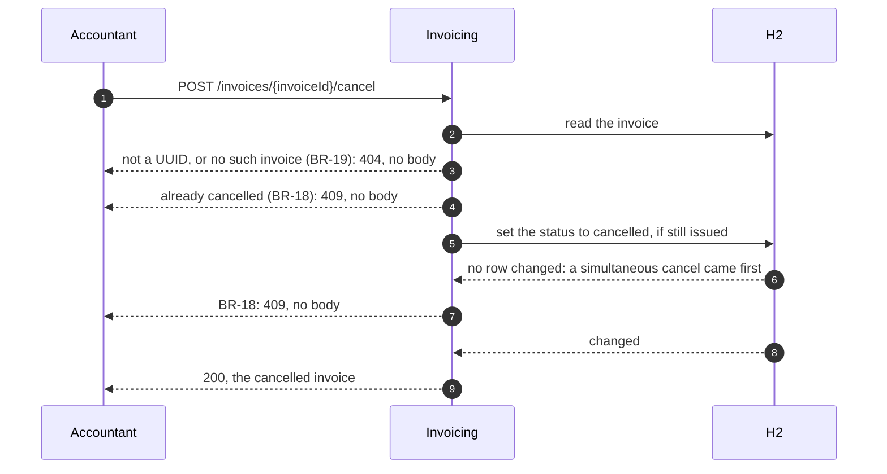

# Cancel an invoice and issue its correction — design

> **Spec:** `docs/specs/billing/invoice/spec.md` (BR-1, BR-3, BR-4, BR-18, BR-19)
>
> **Contract:** `docs/contracts/billing.openapi.json` 1.1.0 (`cancelInvoice`, `issueInvoice`)
>
> **Plan:** `docs/plans/cancel-and-correct-invoice.md`

## Cancel an invoice

`POST /invoices/{invoiceId}/cancel`, through the generated `InvoicesApi`, to a use case of its own.

Drawn from the C4 model, view `cancel-invoice` (`docs/architecture/model.yml`); regenerate with `partition-c4`, never edit here.

1. The identifier is read as for `getInvoice`, by one definition the two use cases share: not a UUID, or naming no invoice, is 404, no body (BR-19, BR-15).
2. The aggregate cancels itself: one guarded method on `Invoice`, per P-1 (`docs/architecture/patterns-grid.md`); an invoice already cancelled refuses (BR-18). It returns the invoice with its status changed and nothing else (BR-3).
3. The port records the change of status only if the recorded status is still the one read: of two cancels at the same moment, the second finds `CANCELLED` and is refused, 409, no body (BR-18).
4. 200 with the invoice, as a read answers it, without its customer (BR-4).

A log line carries the invoice and order identifiers only (rule of `invoice`).

## Issue the correction

No new operation: the accountant issues with `issueInvoice` (Correction). BR-1 moves to "at most one invoice that is not cancelled", still held by the database (architect, 2026-10-19): a migration `V2` replaces the unique key on `order_id` with a unique key on the order of the invoices not cancelled, so that a cancelled invoice frees its order and two simultaneous issues still collide. An issue that races the cancel of its order's invoice meets the key until the cancel has committed: 409.

## Acceptance

Checked once, at delivery, through `./mvnw test`:

- each of BR-1, BR-3, BR-4, BR-18, BR-19 has a test of its trigger and its expected effect;
- a cancelled invoice is read back cancelled, with its lines, amount and order as issued;
- two simultaneous cancels of one invoice give one 200 and one 409; two simultaneous issues of one order still give one 201 and one 409;
- after a cancel, an issue for the same order gives 201, with lines that may differ;
- the tests of the issue and the read written before this feature still pass.
