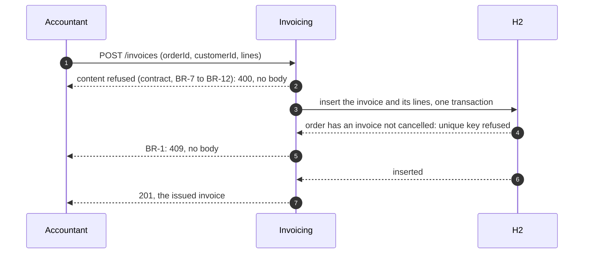

# Issue and read an invoice — design

> **Spec:** `docs/specs/billing/invoice/spec.md` (BR-1, BR-2, BR-7 to BR-17)
>
> **Contract:** `docs/contracts/billing.openapi.json` 1.0.0 (`issueInvoice`, `getInvoice`)
>
> **Plan:** `docs/plans/issue-and-read-invoice.md`

## Issue an invoice

Drawn from the C4 model, view `issue-invoice` (`docs/architecture/model.yml`); regenerate with `partition-c4`, never edit here.

Steps 2, 4–5 and 6–7 are the three outcomes; step 2 comes before any write (BR-13). The invoice and its lines are written in one transaction; BR-1 is held by a unique key on the order (architect, 2026-10-19).

## Acceptance

Checked once, at delivery, through `./mvnw test`:

- each rule BR-1, BR-2, BR-7 to BR-17 has a test of its trigger and its expected effect;
- two simultaneous issues of one order give one 201 and one 409;
- a log line of `invoice` carries identifiers only, nothing of a line or a price (TL).
