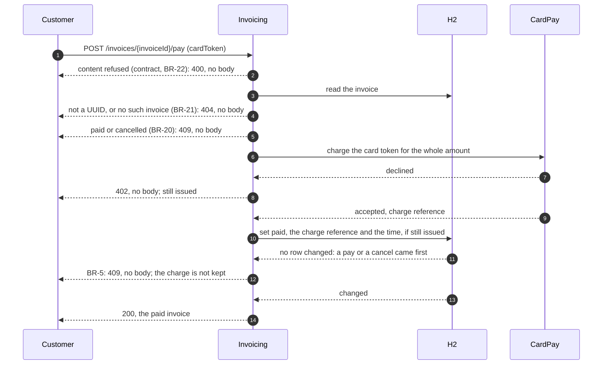

# Pay an issued invoice by card, through CardPay — design

> **Spec:** `docs/specs/billing/invoice/spec.md` (BR-1, BR-3, BR-4, BR-5, BR-12, BR-20, BR-21, BR-22)
>
> **Contract:** `docs/contracts/billing.openapi.json` 1.2.0 (`payInvoice`; `cancelInvoice`, `issueInvoice` for the refusals of a paid invoice)
>
> **Plan:** `docs/plans/pay-invoice-by-card.md`

## Pay an invoice

`POST /invoices/{invoiceId}/pay`, through the generated `InvoicesApi` (the generator does not split by tag: `payInvoice` lands in the one interface), implemented by `InvoiceController`, to a use case of its own, `PayInvoiceUseCase`. The generated `PayInvoice` prints its token in `toString()`: the controller hands the token to the use case and never logs the request model.

Drawn from the C4 model, view `pay-invoice` (`docs/architecture/model.yml`); regenerate with `partition-c4`, never edit here.

1. **Content first (BR-22).** The body is read by the generated model: no body, not JSON, no `cardToken`, a `null` or non-string one are refused by Spring before the use case runs (`HttpMessageNotReadableException`, `MethodArgumentNotValidException`, `com.commerce.JsonConfiguration` refusing coercion): 400, no body. The use case then makes a `CardToken` (domain), bounded by the one definition of a bounded text, `Text` (BR-12): blank or longer, 400, no body. All of it before the invoice is read, so 400 comes before 404 and 409.
2. **The invoice (BR-21, BR-20).** The identifier is read by `InvoiceIds`, shared with `getInvoice` and `cancelInvoice`: not a UUID, or naming no invoice, 404, no body. The aggregate's guard `requirePayable()` refuses a `PAID` or `CANCELLED` invoice: 409, no body, and CardPay is not called.
3. **The charge (BR-5).** The application port `CardPay`, one operation: `charge(CardToken, Money)` answering `Charge.Accepted(chargeReference)` or `Charge.Declined` (a sealed interface). The amount is the invoice's, whole, in its currency, 0 included. Declined: `CardDeclined`, 402, no body, nothing recorded. The charge runs outside any database transaction.
4. **The payment (BR-3, BR-5).** The aggregate's `pay(chargeReference)` checks the status again and bounds the reference by `Text` (BR-12): out of bounds is a defect, `InvalidInvoice` uncaught, 500. It returns the invoice with its status `PAID` and its charge reference, nothing else changed. The port `Invoices.recordPayment(Invoice)` writes the status, the charge reference and the time of the payment — `CURRENT_TIMESTAMP` of the database, in the one-statement transaction that commits it — only if the recorded status is still `ISSUED`. No row changed: `PayRefused`, 409, no body; the charge is kept nowhere (spec, open question). Any other failure of the record: uncaught, 500, the invoice stays `ISSUED`.
5. 200 with the invoice, as a read answers it: without its customer, its time of payment or its charge reference.

### The card token

The token reaches `CardPay` and nothing else: it is not a field of `Invoice`, not recorded, not in a log line, not in an exception message (the domain's messages name a rule, never a value), not in an answer (every refusal has no body). `CardToken` is a record whose `toString()` hides its value, so that a log of the record or of a call to the port shows no token. A log line of `invoice` carries identifiers only (`.claude/rules/backend-security-invoice.md`): "Invoice {} paid for order {}".

### CardPay's adapter

`FakeCardPay`, in `outbound`, the only `CardPay` bean: it accepts every card and answers a charge reference `fake-<UUID>`. No configuration key, no URL, no credentials. A real adapter replaces it when CardPay is reachable.

## A paid invoice, elsewhere

- **Cancel (BR-4).** `Invoice.cancel()` refuses a `PAID` invoice as it refuses a `CANCELLED` one, each naming its rule (BR-4, BR-18): `CancelRefused`, 409, no body. A pay that commits between the cancel's read and its record leaves the cancel's conditional update with no row: 409, as for two cancels.
- **Issue (BR-1).** No change: the key of `V2` holds the order of every invoice whose status is not `CANCELLED`, `PAID` included: 409.
- **Read.** The status `PAID` is answered as the contract's enum names it.

## As delivered

- **No content type (B1, architect).** A pay with no content type keeps the framework's 415, as an issue does; "no body" is a JSON request with an empty body, 400.
- **The card token at DEBUG or TRACE (B2, TL).** The generated `PayInvoice` prints its token, and Spring's web layer logs it at DEBUG or TRACE; accepted for this version, an open question of the spec until a real CardPay adapter comes.

## Data

Migration `V3__record_the_payment.sql`: `invoice` gains `paid_at TIMESTAMP WITH TIME ZONE` and `charge_reference VARCHAR(510)` (255 code points, as `V1` sizes a text), both `NULL` while the invoice is not paid. `JdbcInvoices.find` reads the charge reference back into the aggregate; `paid_at` is read by no code until BR-6 needs it.

## Patterns

- The status stays ruled by P-1 (`docs/architecture/patterns-grid.md`): two guarded methods on the aggregate, `requirePayable()` and `pay(chargeReference)`, no State; to be checked in Task 4 against its re-ruling conditions.
- **Ports and adapters** (the hexagon's own form): `CardPay` is an application port, `FakeCardPay` its outbound adapter, the same shape as `Invoices` / `JdbcInvoices`.
- `Charge` is a sealed interface of two records, a closed result read by a `switch`; no GoF pattern is needed.

## Acceptance

Checked once, at delivery, through `./mvnw test`, in one class `PayInvoiceTest` (one test class per use case) and the existing `CancelInvoiceTest` and `IssueInvoiceTest`:

- an `ISSUED` invoice paid: 200, status `PAID`, lines, amount and order as issued, no customer; read back `PAID`; CardPay asked once, for the whole amount in its currency;
- an invoice whose amount is 0 is charged for 0;
- CardPay declines (a spy on `FakeCardPay`): 402, no body; read back `ISSUED`; then cancelled with 200;
- a `PAID` and a `CANCELLED` invoice: 409, no body, CardPay not called;
- 404, no body, for an identifier naming no invoice and for one not a UUID, CardPay not called;
- 400, no body, for no body, invalid JSON, no `cardToken`, `null`, a number, a blank token, a token of 256 characters — with an unknown identifier too (400 before 404); a token of 255 characters is accepted;
- two simultaneous pays of one invoice: one 200, one 409;
- the record failing (a spy on `Invoices`): 500, read back `ISSUED`;
- a charge reference out of bounds (a spy on `FakeCardPay`): 500, read back `ISSUED`;
- the card token appears in no output of the application (log captured) and in no answer, on every path above;
- in `CancelInvoiceTest`: a cancel of a paid invoice, 409, no body, read back `PAID`; in `IssueInvoiceTest`: an issue for the order of a paid invoice, 409;
- the tests written before this feature still pass.
